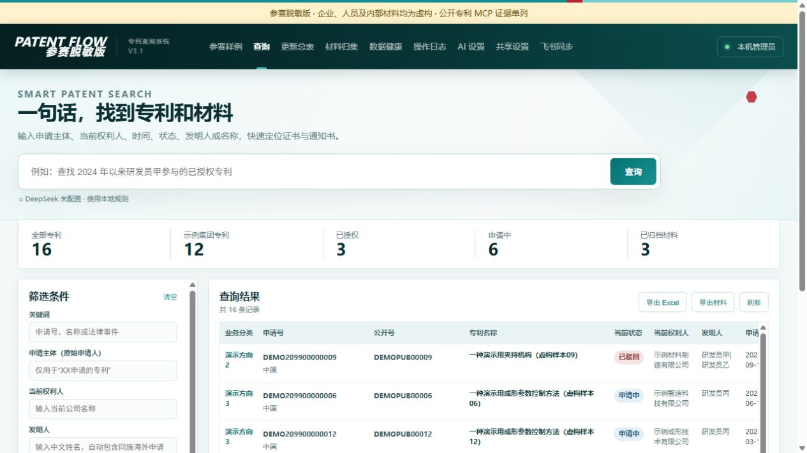
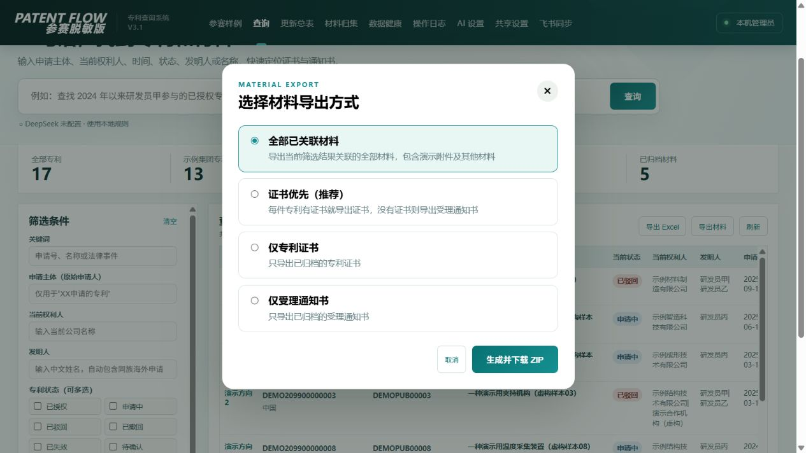

# 专利总表维护助手

开源的专利台账维护 Skill 和本地网页应用。首次运行为空库，支持 Excel 导入与差异预览、同族查询、材料归集与导出，以及本地自然语言查询。

## 界面展示

以下为原版应用使用虚构示例数据的界面截图，用于展示查询筛选和材料导出功能。截图中的案件与数量是演示状态；开源版首次启动为空库。

### 专利查询

支持自然语言查询、申请号检索及主体、发明人、状态、日期等条件筛选，可查看关联材料并导出结果。

### 材料导出

可选择全部已关联材料、证书优先、仅专利证书或仅受理通知书，生成 ZIP 下载。

## 启动

Windows：安装 Python 3.12（64 位，含 pip 和 venv），双击 `安装依赖.cmd`，再双击 `启动演示.cmd`。浏览器访问 `http://127.0.0.1:18879`。支持环境、使用方法和功能边界详见 [SKILL.md](SKILL.md)。

## 数据与外部服务

仓库不包含专利台账、附件、密钥或账号配置。实时智慧芽 MCP/API、AI、OCR 和飞书功能需要使用者自行配置。法律状态仅用于辅助核对，不能替代原始法律文件。

## 许可

项目代码采用 MIT License；第三方依赖和数据服务分别适用其自身许可和服务条款。

